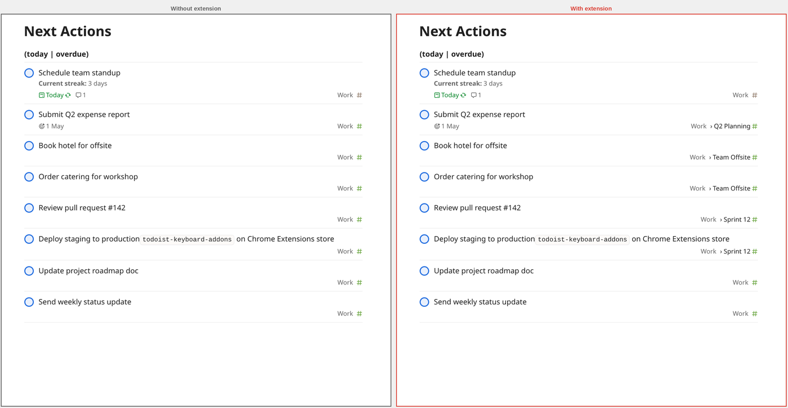

Todoist Keyboard Add-ons
=========================

A small, focused Tampermonkey / Violentmonkey userscript for the [Todoist](https://app.todoist.com) web app on Chrome and Firefox that adds extra keyboard shortcuts and quality-of-life features. All shortcuts and features are configurable right inside Todoist's own **Settings → Keyboard Add-ons** tab (or from the userscript manager's toolbar menu).

## Features

### Parent task label in filter / search views

When browsing a filter, search, Today, or Upcoming view, Todoist shows the project name (e.g. `Work #`) in the bottom-right corner of each task. For subtasks this gives no context about what the parent task is.

With this feature enabled, the label is replaced with **`Project › Parent Task Title`** for subtasks. Top-level tasks are unaffected. This relies on Todoist's local IndexedDB cache — no extra API calls are made.



Can be toggled on/off from **Settings → Keyboard Add-ons**.

## Keyboard shortcuts

### Task list

| Shortcut       | Action                                             |
|----------------|----------------------------------------------------|
| Alt+Shift+Up   | Move the focused task up (simulates drag-and-drop) |
| Alt+Shift+Down | Move the focused task down                         |
| Alt+K          | Open the first external link in the focused task   |
| Alt+N          | Copy the name of the focused or selected task(s)   |
| PageUp         | Move keyboard focus up by one page                 |
| PageDown       | Move keyboard focus down by one page               |
| Home           | Move keyboard focus to the first task              |
| End            | Move keyboard focus to the last task               |

### Task detail (modal)

| Shortcut | Action                                                                                           |
|----------|--------------------------------------------------------------------------------------------------|
| Alt+Up   | Navigate to the parent project via the breadcrumb link                                           |
| Alt+O    | Open the "More actions" menu                                                                     |
| ↑        | Move keyboard focus to the previous sub-task                                                     |
| ↓        | Move keyboard focus to the next sub-task                                                         |
| PageUp   | Move keyboard focus up by one page of subtasks                                                   |
| PageDown | Move keyboard focus down by one page of subtasks                                                 |
| Home     | Move keyboard focus to the first subtask                                                         |
| End      | Move keyboard focus to the last subtask                                                          |
| Alt+H    | Toggle show/hide completed sub-tasks                                                             |

## Installation

1. Install [Tampermonkey](https://www.tampermonkey.net/) or [Violentmonkey](https://violentmonkey.github.io/) in Chrome or Firefox.
2. Open the latest release userscript:
   **[Install Todoist Keyboard Add-ons](https://github.com/hron/todoist-keyboard-addons/releases/latest/download/todoist-keyboard-addons.user.js)**
3. Click **Install** in the prompt. Future releases update automatically via `@updateURL` / `@downloadURL`.

### Building from source

```bash
npm run build
```

This generates `dist/todoist-keyboard-addons.user.js` and `dist/todoist-keyboard-addons.meta.js` with no external dependencies (Node.js only).

### Live local development (no caching)

Tampermonkey caches `@require` scripts internally and does not refetch them on page reload. Instead, `npm run dev` serves a separate **`(Local Dev)`** loader userscript that fetches a freshly rebuilt bundle from `127.0.0.1:4174` on every page load via `GM_xmlhttpRequest` (so edits take effect immediately on `F5`, and you can keep your stable script installed and toggle between them in Tampermonkey):

1. Start the dev server (rebuilds from `src/` automatically on every request):
   ```bash
   npm run dev
   ```
2. Open **`http://127.0.0.1:4174/dev-loader.user.js`** in your browser and click **Install** in Tampermonkey.
3. In the Tampermonkey Dashboard, disable the stable **Todoist Keyboard Add-ons** script and enable **Todoist Keyboard Add-ons (Local Dev)** while testing.
4. Edit files in `src/` and reload `app.todoist.com` — DevTools Console logs `[todoist-kbd dev] Loaded fresh build (<hash>, <bytes>B via <mode>)` on each reload (or warns if `npm run dev` isn't running).

## Configuration

- Open Todoist **Settings** and select **Keyboard Add-ons** in the left sidebar, **or** click **Settings** in the Tampermonkey / Violentmonkey toolbar menu on any Todoist page.
- Click any shortcut field and press your desired key combination. Changes are saved automatically (`GM_setValue`) and synced live across open Todoist tabs.
- For multi-device sync, enable your userscript manager's built-in cloud sync (Tampermonkey Settings → Storage / Sync, or Violentmonkey Sync).

## Publishing (maintainer notes)

### Releasing

```bash
# bump version in package.json, then:
git add package.json
git commit -m "Bump version to X.Y.Z"
git tag vX.Y.Z
git push && git push --tags
```

The workflow (`.github/workflows/release.yml`) runs `npm test` (building and verifying the userscript with Playwright) and attaches `todoist-keyboard-addons.user.js` and `todoist-keyboard-addons.meta.js` to the GitHub Release.
